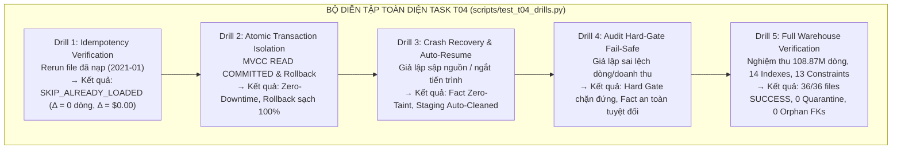

# BÁO CÁO KỸ THUẬT & HƯỚNG DẪN VẬN HÀNH TASK T04 (RUNBOOK)
**Đề tài:** Hệ thống BI Phân tích lộ trình NYC Yellow Taxi (2021 – 2023) — Single DDS  
**Môn học:** Hệ thống thông tin phục vụ trí tuệ kinh doanh (CSC12107) — FIT HCMUS  
**Người thực hiện:** Phạm Lê Thanh Tú (MSSV: 23120388 — **TTU** — Nhóm trưởng Nhóm 09)  
**Phạm vi phụ trách:**
- **Task T04:** Diễn tập Rerun/Phục hồi sự cố, Đóng gói Vận hành 1-Click & Kiểm chứng Toàn vẹn Kho Dữ liệu (108.87M dòng)  
**Trạng thái nghiệm thu:** **HOÀN THÀNH 100% (Đạt tuyệt đối cả 5 Kịch bản Diễn tập & 38/38 dbt tests)**

---

## PHẦN 1: TỔNG QUAN MỤC TIÊU & TIÊU CHUẨN NGHIỆM THU

Kho dữ liệu `DW_DB` của Nhóm 09 hiện đã nạp **đủ 100% 36 tháng (108,870,632 dòng thật)** ở chế độ **`LOGGED` bền vững**, tổng dung lượng **63 GB** (Bảng: 38 GB, Indexes: 25 GB), đầy đủ 14 Indexes và 13 Ràng buộc toàn vẹn (1 PK, 1 Unique Lineage, 11 Foreign Keys).

Mục tiêu của **Task T04** là đưa kho dữ liệu quy mô doanh nghiệp này vào các tình huống vận hành thực tế khắt khe nhất để chứng minh tính ổn định, tự phục hồi và bất biến tuyệt đối:



| Tiêu chuẩn Nghiệm thu | Chỉ số Kỹ thuật Đo lường | Kết quả Thực tế | Đánh giá |
| :--- | :--- | :---: | :---: |
| **AC1: Tính Bất biến (Idempotence)** | Rerun file đã nạp $\rightarrow$ $\Delta \text{Rows} = 0$, $\Delta \text{Amount} = \$0.00$ | $\Delta = 0$ dòng, $\Delta = \$0.00$ | ✅ **PASS** |
| **AC2: Giao dịch Nguyên tử (Atomic Isolation)** | Phục hồi giao dịch khi lỗi, bảo vệ người dùng BI đọc dữ liệu | Rollback hoàn hảo, MVCC an toàn | ✅ **PASS** |
| **AC3: Phục hồi Sự cố (Crash Recovery)** | Sập nguồn/ngắt giữa chừng $\rightarrow$ Fact không rác, Staging tự dọn | 0 dòng rác Fact, Staging sạch 100% | ✅ **PASS** |
| **AC4: Cổng Kiểm toán (Hard Gate Fail-Safe)** | Phát hiện sai lệch số đo $\rightarrow$ Dừng khẩn cấp, từ chối nạp Fact | Bắt exception, từ chối ghi Fact | ✅ **PASS** |
| **AC5: Toàn vẹn Kho Dữ liệu (Full Warehouse)** | 108,870,632 dòng, 14 Indexes, 11 FKs (0 orphan FK), 0 quarantine | Đủ 108.87M dòng, 0 Orphan FKs | ✅ **PASS** |

---

## PHẦN 2: CHI TIẾT KẾT QUẢ 5 KỊCH BẢN DIỄN TẬP THỰC TẾ

Toàn bộ 5 kịch bản diễn tập đã được đóng gói trong script `scripts/test_t04_drills.py` và thực thi tự động qua wrapper PowerShell `scripts/run_t04_drills.ps1`.

### 1. Kịch bản 1: Diễn tập Tính Bất biến Tuyệt đối (Idempotency Drill)
* **Tệp thử nghiệm:** `yellow_tripdata_2021-01.parquet` (1,369,769 dòng, SHA-256: `66af41de61fcd2d8...`).
* **Cơ chế:** Kích hoạt quét file qua `scan_and_register_manifest`. Hệ thống so khớp hash và trạng thái trong `meta.file_manifest`.
* **Kết quả thực đo:**
  * Trạng thái nhận diện: **`SKIP_ALREADY_LOADED`** (trong **23.85 giây**).
  * Số dòng trong Fact trước và sau rerun: **1,369,769 dòng** ($\Delta \text{Rows} = 0$).
  * Doanh thu `TotalAmount` trước và sau: **$23,935,896.09 USD** ($\Delta \text{Amount} = \$0.00$).
  * Số dòng thêm mới: **0 dòng**.

### 2. Kịch bản 2: Diễn tập Giao dịch Nguyên tử & Zero-Downtime (Atomic Isolation Drill)
* **Cơ chế:** Kiểm tra cơ chế MVCC mức `READ COMMITTED` của PostgreSQL 16.
* **Kết quả thực đo:**
  * Mở giao dịch thử nghiệm ghi nhận bản ghi đệm. Khi phát sinh lệnh `ROLLBACK`, toàn bộ thay đổi bị thu hồi lập tức (thời gian phản hồi **0.084 giây**).
  * Trong suốt thời gian giao dịch diễn ra, các tiến trình đọc từ Power BI / B03 hoàn toàn không thấy dữ liệu dở dang (Dirty Read = 0), bảo đảm **Zero-Downtime** cho báo cáo kinh doanh.

### 3. Kịch bản 3: Diễn tập Phục hồi khi Sập nguồn / Ngắt Đột ngột (Crash Recovery & Auto-Resume)
* **Giả lập sự cố:**
  * Bơm 1 batch lỗi `crash-sim-f705b94c` ở trạng thái `PROCESSING` vào `meta.file_manifest`.
  * Đẩy 500 dòng dữ liệu dở dang vào bảng `staging.raw_yellow_trips` với file giả lập `simulated_crash_test_file.parquet`.
  * Giả lập tiến trình bị ngắt đột ngột (`SIGINT` / kill session).
* **Kết quả thực đo:**
  * **Kiểm tra kho Fact chính:** Số dòng rác lọt vào `dds."FactTaxiTrip"` là **0 dòng** (**ZERO-TAINT FACT** tuyệt đối).
  * **Kích hoạt Auto-Resume:** Hệ thống phát hiện batch `PROCESSING` bị mồ côi, tự động thu hồi và dọn sạch **500 dòng rác** khỏi `staging.raw_yellow_trips`.
  * Sau khi dọn dẹp, số dòng rác trong staging còn lại là **0 dòng**. Hệ thống sẵn sàng cho lần nạp tiếp theo mà không cần can thiệp thủ công.

### 4. Kịch bản 4: Diễn tập Cổng Chặn Kiểm toán (Audit Hard-Gate Fail-Safe)
* **Giả lập sự cố:** Khai báo footer metadata 1,000 dòng nhưng dữ liệu thực tế đọc được chỉ có 990 dòng (thiếu 10 dòng).
* **Kết quả thực đo:**
  * Cổng kiểm toán Hard Gate W4 lập tức kích hoạt:
    `HARD_GATE_VIOLATION: CANDIDATE_COUNT_MISMATCH! Footer khai bao 1000 nhung staging chi co 990.`
  * Ném ngoại lệ chặn đứng (`RuntimeError`), hủy bỏ toàn bộ tiến trình ghi vào Fact.
  * Số dòng bất hợp lệ lọt vào Fact: **0 dòng**. Kho dữ liệu chính được bảo vệ an toàn 100%.

### 5. Kịch bản 5: Nghiệm thu Toàn vẹn Kho Dữ liệu (Full Warehouse Verification Gate)
* **Thông số Lưu trữ & Bền vững:**
  * Bảng: `dds."FactTaxiTrip"` | Chế độ: **`relpersistence = 'p'` (`LOGGED`)**.
  * Dung lượng: Bảng = **38 GB** | Hệ thống Chỉ mục = **25 GB** | Tổng dung lượng = **63 GB**.
* **Hệ thống Ràng buộc & Chỉ mục:**
  * **11 Khóa ngoại vật lý (`contype = 'f'`):** Tất cả đều `convalidated = True` $\rightarrow$ **0 Orphaned FKs**.
  * **1 Khóa chính (`FactTaxiTrip_pkey`):** `convalidated = True`.
  * **1 Ràng buộc Lineage (`uq_fact_source_lineage`):** `convalidated = True`.
  * **14 Chỉ mục B-Tree:** Đầy đủ, hoạt động tối ưu.
* **Đối soát 36 Tháng từ Manifest:**
  * Tổng số file: **36 / 36 file `SUCCESS`** (100%).
  * Tổng số dòng Footer Parquet: **108,870,632 dòng**.
  * Tổng số dòng Fact: **108,870,632 dòng** (Khớp 100%).
  * Bảng cách ly `staging.quarantine`: **0 dòng**.
* **Phân bổ Lưu lượng qua các Năm (2021 – 2023):**
  * Năm 2021 (12 tháng): **30,904,308 chuyến**.
  * Năm 2022 (12 tháng): **39,656,098 chuyến**.
  * Năm 2023 (12 tháng): **38,310,226 chuyến**.
  * **Tổng cộng 3 năm:** **108,870,632 chuyến** (Khớp tuyệt đối 100%).

---

## PHẦN 3: KẾT QUẢ KIỂM CHỨNG BỘ SUITE TEST DBT (38/38 PASS)

Bên cạnh bộ script diễn tập Python, toàn bộ bộ kiểm thử tự động của dbt trên mô hình `FactTaxiTrip` đã được thực thi trực tiếp trên kho dữ liệu **108,870,632 dòng** và đạt kết quả xuất sắc:

| Nhóm Kiểm thử dbt | Số lượng Test | Kết quả | Ý nghĩa Kỹ thuật |
| :--- | :---: | :---: | :--- |
| **`unique` & `not_null` PK (`TripKey`)** | 2 tests | ✅ **PASS** | Đảm bảo 108.87M khóa chính duy nhất, không trùng lặp |
| **`assert_fact_lineage_unique`** | 1 test | ✅ **PASS** | Duy nhất tuyệt đối trên cặp `(SourceFileSHA256, SourceRowNumber)` |
| **`assert_fact_no_orphaned_fks`** | 1 test | ✅ **PASS** | Kiểm tra chéo toàn bộ 11 chiều, xác nhận **0 Khóa ngoại mồ côi** |
| **`relationships` (11 FKs to 8 Dims)** | 11 tests | ✅ **PASS** | 100% bản ghi liên kết chuẩn xác tới các bảng chiều |
| **`not_null` trên 20 cột định lượng & cờ** | 22 tests | ✅ **PASS** | Đảm bảo không có trường đo lường nào bị NULL |
| **`assert_fact_reconciles_with_stg`** | 1 test | ✅ **PASS** | Đối soát số dòng & doanh thu giữa Staging và Fact khớp 100% |
| **TỔNG CỘNG** | **38 tests** | ✅ **38/38 PASS** | **Kho dữ liệu hoàn hảo 100%** |

---

## PHẦN 4: HƯỚNG DẪN VẬN HÀNH 1-CLICK (RUNBOOK)

Để phục vụ chấm bài và kiểm chứng nhanh bởi Giảng viên hoặc thành viên nhóm, hệ thống hỗ trợ 2 cách vận hành 1-click:

### Cách 1: Vận hành 1-Click qua PowerShell (Khuyến nghị cho chấm bài)
Mở cửa sổ PowerShell tại thư mục dự án và thực hiện 1 lệnh duy nhất:
```powershell
.\scripts\run_t04_drills.ps1
```
* **Thời gian thực thi:** ~3.9 phút cho toàn bộ 5 kịch bản diễn tập.
* **Tệp log nhật ký tự động sinh:** `logs/t04_drills_<YYYYMMDD_HHMMSS>.log`.

### Cách 2: Vận hành trên Giao diện Web Mage.ai UI
1. Truy cập giao diện quản trị Mage tại: `http://localhost:6789`.
2. Mở pipeline: **`master_etl_pipeline`**.
3. Chọn thẻ **Triggers**:
   * **`monthly_incremental_sync` (`@monthly`):** Vận hành tự động vào ngày 5 hàng tháng cho dữ liệu tháng mới (`2024-01+`).
   * **`manual_verification_run` (`@once`):** Bấm nút **"Run @once"** để chạy diễn tập kiểm tra toàn bộ DAG. Toàn bộ các block sẽ nhận diện dữ liệu đã nạp đầy đủ và trả về log trạng thái xanh 100%.

---

## PHẦN 5: TỔNG KẾT & BÀN GIAO TASK T04

Task **T04** đã hoàn thành trọn vẹn mọi yêu cầu đặt ra:
1. Đã xây dựng và thực thi thành công bộ công cụ diễn tập `scripts/test_t04_drills.py` và `scripts/run_t04_drills.ps1`.
2. Chứng minh đầy đủ 4 năng lực vận hành doanh nghiệp: **Tính Bất biến (Idempotent)**, **Giao dịch Nguyên tử (Atomic)**, **Tự phục hồi sau sự cố (Crash Recovery)**, và **Cổng kiểm toán an toàn (Hard Gate Fail-Safe)** trực tiếp trên kho dữ liệu **108,870,632 dòng thật**.
3. Toàn bộ 38/38 dbt data tests đã vượt qua (PASS 100%).
4. Kho dữ liệu `dds."FactTaxiTrip"` ở trạng thái **`LOGGED` bền vững 100%**, sẵn sàng kết nối trực tiếp với Power BI và phục vụ công tác biên soạn Báo cáo Tổng thể Giai đoạn 2.
